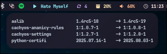
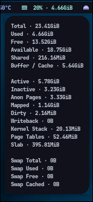
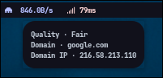
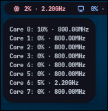

# Modules

Each module outputs single-line JSON compatible with Waybar’s `custom` module interface.

## Configuration

Modules that support configuration look for a `.zon` file in `~/.config/zig-waybar-contrib/`.
The filename must match the module name (e.g., `ping.zon` for the ping module).

---

### **CPU**

Displays per-core CPU usage and frequency information.

- **Signal:** `10`
- **Platforms:** Any Linux

**Configuration (`~/.config/zig-waybar-contrib/cpu.zon`):**
```zig
.{
    // Check interval in seconds
    .update_interval = 1,
    // Module icon
    .icon = "",
}
```

---

### **Fan**

Monitors fan speeds.

- **Signal:** `11`
- **Platforms:** Any Linux

**Configuration (`~/.config/zig-waybar-contrib/fan.zon`):**
```zig
.{
    // Check interval in seconds
    .update_interval = 5,
    // Module icon
    .icon = "",
}
```

---

### **Memory**

Reports RAM usage and memory statistics.

- **Signal:** `12`
- **Platforms:** Any Linux

**Configuration (`~/.config/zig-waybar-contrib/memory.zon`):**
```zig
.{
    // Check interval in seconds
    .update_interval = 1,
    // Module icon
    .icon = "",
}
```

---

### **Ping**

Measures network latency to a configurable host using ICMP.

- **Signal:** `13`
- **Platforms:** Any Linux

**Configuration (`~/.config/zig-waybar-contrib/ping.zon`):**
```zig
.{
    // Check interval in seconds
    .update_interval = 1,
    // Target domain to ping
    .target_domain = "google.com",
    // Interval to refresh the resolved IP address (seconds)
    .target_domain_ip_update_interval = 200,
    // Ping timeout in milliseconds
    .ping_timeout_ms = 5000,
    // Module icon
    .icon = "󰛳",
}
```

---

### **Updates**

Tracks available system package updates.

- **Signal:** `14`
- **Platforms:** Arch Linux, Debian, Fedora, OpenSUSE, Void Linux
- **Managers:** pacman, apt, dnf, zypper, xbps

**Configuration (`~/.config/zig-waybar-contrib/updates.zon`):**
```zig
.{
    // Check interval in seconds
    .update_interval = 200,
    // Package manager override (optional)
    // .manager = "pacman", 
    // Module icon
    .icon = "",
    // Error icon
    .err_icon = "",
}
```

---

### 📸 Screenshots

| Module      | Preview                               |
| :---------- | :------------------------------------ |
| **Updates** |  |
| **Memory**  |    |
| **Ping**    |        |
| **CPU**     |          |