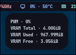

# Modules

Each module outputs single-line JSON compatible with Waybar’s `custom` module interface.

## Configuration

Modules that support configuration look for a `.zon` file in `~/.config/zig-waybar-contrib/`.
The filename must match the module name (e.g., `ping.zon` for the ping module).

---

### **CPU**

Displays per-core CPU usage and frequency information.

- **Signal:** `10`
- **Platforms:** Any Linux

**Configuration (`~/.config/zig-waybar-contrib/cpu.zon`):**
```zig
.{
    // Check interval in seconds
    .check_interval = 1,
    // Module icon
    .icon = "X",
}
```

---

### **Fan**

Monitors fan speeds.

- **Signal:** `11`
- **Platforms:** Any Linux

**Configuration (`~/.config/zig-waybar-contrib/fan.zon`):**
```zig
.{
    // Check interval in seconds
    .check_interval = 5,
    // Module icon
    .icon = "X",
}
```

---

### **GPU**

Monitors GPU utilization, temperature, memory, and fan/PWM speeds.

- **Signal:** `12`
- **Platforms:** Any Linux with supported drivers
- **Vendors:** AMD, NVIDIA

**Configuration (`~/.config/zig-waybar-contrib/gpu.zon`):**
```zig
.{
    // Check interval in seconds
    .check_interval = 1,
    // Module icon
    .icon = "X",
}
```

---

### **Memory**

Reports RAM usage and memory statistics.

- **Signal:** `13`
- **Platforms:** Any Linux

**Configuration (`~/.config/zig-waybar-contrib/memory.zon`):**
```zig
.{
    // Check interval in seconds
    .check_interval = 1,
    // Module icon
    .icon = "X",
}
```

---

### **Network**

Monitors network statistics including local and gateway IPs, upload/download rates, and gateway latency.

- **Signal:** `14`
- **Platforms:** Any Linux

**Configuration (`~/.config/zig-waybar-contrib/network.zon`):**
```zig
.{
    // Check interval in seconds
    .check_interval = 1,
    // Module icon
    .icon = "X",
}
```

---

### **Ping**

Measures network latency to a configurable host.

- **Signal:** `15`
- **Platforms:** Any Linux

**Configuration (`~/.config/zig-waybar-contrib/ping.zon`):**
```zig
.{
    // Target domain to ping
    .target_domain = "google.com",
    // Timeout in seconds
    .timeout_seconds = 10,
    // Module icon
    .icon = "X",
}
```

---

### **Updates**

Tracks available system package updates.

- **Signal:** `16`
- **Platforms:** Arch Linux, Debian, Fedora, OpenSUSE
- **Managers:** pacman, apt, dnf, zypper

**Configuration (`~/.config/zig-waybar-contrib/updates.zon`):**
```zig
.{
    // Check interval in seconds
    .check_interval = 200,
}
```

---

### 📸 Screenshots

| Module      | Preview                               |
| :---------- | :------------------------------------ |
| **Updates** |  |
| **GPU**     |          |
| **Memory**  |    |
| **Ping**    |        |
| **CPU**     |          |